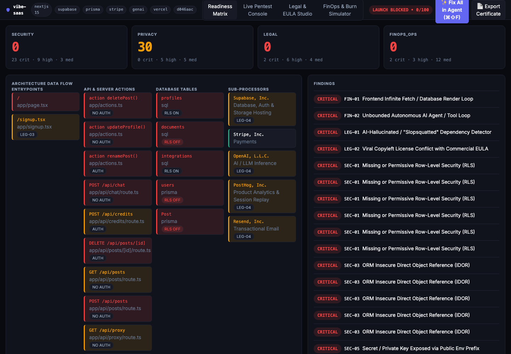

# Gantry

Gantry checks whether an AI-generated repo is ready to launch. It runs four tools in one CLI:

- a **static readiness scanner** with 74 rules (including opt-in compliance packs) across security, privacy, legal and FinOps/ops, plus a dependency-risk check that names the few CVEs that matter
- a **legal compiler** for privacy policy, terms and EULA, plus a sub-processor list
- a **FinOps burn guard**
- a **non-destructive active pentester** that only targets localhost by default

A cold scan of a 500-file repo takes about 0.3 s. The hard limit is 3 s, and `bun run bench` checks it.



## Quick start

You need Bun ≥ 1.2.

```bash
bun install
```

```bash
bun run scan fixtures/vulnerable-saas
```

Or install the standalone binary (checksum-verified; no Go/Rust rules, use `bunx @usegantry/cli` for those):

```bash
curl -fsSL https://usegantry.app/install.sh | sh
```

## GitHub

Verified certificate + badge (the signer only trusts this reusable workflow, via GitHub OIDC):

```yaml
jobs:
  gantry:
    permissions: { contents: read, id-token: write, security-events: write }
    uses: askp-dev/usegantry/.github/workflows/scan.yml@v1
    with: { strict: false }   # strict: true fails the job on LAUNCH_BLOCKED
```

Or the plain action (self-signed, no OIDC): `uses: askp-dev/usegantry@v1` with `strict`, `profile` and `path` inputs. Both upload SARIF to code scanning and the badge + report as a build artifact; neither commits to your repo.

To build a standalone binary at `packages/core/dist/gantry`:

```bash
bun run build:bin
```

## Commands

| Command | What it does |
|---|---|
| `gantry scan [path] [--json\|--sarif\|--compact] [--changed-only] [--only DEP-01,DEP-02] [--strict] [--offline] [--write-checklist]` | Static audit. Exits 1 when there are launch blockers. `--compact` prints one token-lean line per finding; `--changed-only` scans uncommitted files only and skips repo-wide absence rules; `--only` runs just the named rules (the daily advisory re-check). |
| `gantry sbom [path] [--out sbom.cdx.json] [--offline]` | CycloneDX 1.6 SBOM of the resolved dependencies (purls, direct vs transitive, licences where known), with a `vulnerabilities` section for the known advisories when online or cached. |
| `gantry legal [path] [--sync]` | Compiles `legal/*.md` from the vendors, PII and clauses it detects. Shows a diff unless you pass `--sync`. |
| `gantry clear [path] [--allow-blocked]` | Launch Clearance Certificate (Ed25519, HTML + PDF) plus a vendor pack (SBOM, `DATA_FLOW.mermaid`). Local certs are **self-signed**; only the official workflow's `--central` certs are Verified. |
| `gantry check <github-url\|path> [--json\|--md] [--online]` | Plain-language report for the repo owner: score, one-sentence status, the top 5 fixes with copy-paste prompts for your AI agent. Downloads public (or, with `GITHUB_TOKEN`/`gh auth`, private) GitHub repos as a tarball: no clone, no installs, no scripts, static rules only. |
| `gantry roast <github-url\|path> [--json] [--out card.svg]` | Shareable 1200×630 "Vibe-Code Survival Card". Never shows file paths, routes, line numbers, tables or secrets, so it's safe to post. |
| `gantry badge [path] [--cert <verify-url>]` | Writes `.gantry/badge.svg` and prints a README snippet linking to your certificate. |
| `gantry attack --target http://localhost:3000 [path]` | Live probes PT-01..06 against routes the static scan found. Non-loopback targets need `--allow-remote`. |
| `gantry ui [path] [--port 4400] [--online]` | Mission Control at `http://127.0.0.1:4400`, with Readiness Matrix, Live Pentest, Legal Studio and Burn Simulator tabs. |
| `gantry init [path] [--ci] [--pre-commit] [--no-hooks]` | Adds the MCP config, `CLAUDE.md`/Cursor rules, `gantry.config.json`, Claude Code/Cursor stop hooks (opt-in `git commit` gate) and a `.gantry/baseline.json`, so the hooks block only on blockers introduced after init. It's non-destructive and safe to re-run. |
| `gantry hook <stop\|pre-commit> [path] --agent claude\|cursor` | The agent hook entry point (reads the hook event JSON on stdin). |
| `gantry mcp` | Stdio MCP server with the tools `run_readiness_audit`, `sync_stack_legal_docs` and `run_active_pentest`. |

Exit codes: `0` ok · `1` launch blockers · `2` usage or runtime error.

## Rules

| Pillar | Rules |
|---|---|
| Security | SEC-01 … SEC-12 (RLS, definer functions, IDOR, public buckets, leaked or historical secrets, auth ordering, webhook signatures, AI endpoint abuse, headers, XSS) |
| Privacy | PRIV-01 … PRIV-07 (erasure cascades, plaintext tokens, ungated analytics, data export) |
| Dependencies | DEP-01 (known-exploited or high CVEs, ranked by whether your code imports the package), DEP-02 (releases younger than `minReleaseAgeDays`), DEP-03 (missing/stale lockfile, `*`/`latest`, unpinned git deps, unvetted install scripts) |
| Legal | LEG-01 … LEG-06 (slopsquatted packages, copyleft vs EULA, clickwrap, sub-processor drift, legal routes, AI disclaimer) |
| FinOps / Ops | FIN-01..03, PAY-01..03, OPS-01..04, A11Y-01, SEO-01 |

Scoring: CRITICAL costs −25 and always blocks. HIGH costs −10 and blocks only with `--strict`. MEDIUM costs −4. Every finding comes with evidence, a plain-English impact and a ready-to-paste `agentRemediationPrompt`.

To suppress a finding, put `// gantry-ignore SEC-03` on the line or the line above it, or add the rule to `ignoreRules` in `gantry.config.json`.

## When the next CVE drops

A wall of every CVE buries the one that matters. DEP-01 sends one OSV.dev batch query per scan (package names and
versions only, never code), joins it with the CISA KEV catalogue, and reports one finding per package:

- **CRITICAL** when the advisory is known-exploited (KEV) **and** your code imports the package or it's a direct runtime dependency.
- **HIGH** for CVSS ≥ 7 with a fixed release, or known-exploited but only pulled in transitively.
- Everything else is one line: "14 lower-severity advisories, none known-exploited or CVSS >= 7 with a fix".

The fix names the first fixed version on the same major. Private-looking names (local, git and private-registry deps,
scoped packages Gantry can't confirm as public, `privatePackages`, `GOPRIVATE`) are never sent. Results are cached for
24 h in `.gantry/advisories/` (self-ignoring); `--offline` uses that cache, and with no cache DEP-01 reports a notice
instead of a pass. DEP-02 holds back releases younger than 7 days (set `minReleaseAgeDays`), the window in which
hijacked-maintainer releases are usually pulled, and recommends your package manager's own minimum-release-age setting.

To accept a specific advisory, add `{ "id": "CVE-…", "reason": "…", "expires": "YYYY-MM-DD" }` to `ignoreAdvisories`
in `gantry.config.json`, or put `# gantry-ignore DEP-01 <id> <reason>` in a manifest that allows comments.
`gantry init --ci` adds a daily re-check workflow that keeps one issue up to date and never commits.

`gantry sbom` helps with the EU Cyber Resilience Act's SBOM and vulnerability-handling duties. It doesn't make a
product CRA-compliant on its own.

## Packages

| Path | Contents |
|---|---|
| `packages/core` | Context builder, rules, engine, compilers, pentester, MCP and UI servers, CLI. No runtime dependencies. |
| `packages/ui` | Svelte 5 + Tailwind v4 Mission Control. Build it with `bun run build:ui`. Without it, the server falls back to the embedded lite UI. |
| `packages/mcp` | `@usegantry/mcp`: `bunx @usegantry/mcp` runs the MCP server on its own. |
| `packages/signer` | Cloudflare Worker at `api.usegantry.app/sign` that signs certificates for the official workflow (GitHub OIDC). |
| `packages/vscode-ext` | Diagnostics, CodeLens "Fix with AI Agent" and a sidebar. Package it with `bun run --cwd packages/vscode-ext package`. |
| `fixtures/vulnerable-saas`, `fixtures/clean-saas` | Every rule must fire on the first and stay silent on the second. |

## Development

```bash
bun test packages/core/test
```

```bash
bun run typecheck
```

```bash
bun run bench
```

Environment variables:

- `GANTRY_CERT_SECRET` makes certificate signing deterministic, which you want in CI.
- `GANTRY_VERIFY_BASE` sets the verify-page origin (default `https://usegantry.app`).
- `GITHUB_TOKEN` / `GH_TOKEN` let `check`/`roast` read private repos. The token is sent only to `api.github.com`.

JSON contracts for `check --json` and `roast --json`: `docs/check-json.md`.

## Contributing and licence

MIT (`LICENSE`). Contributions need a [DCO](https://developercertificate.org/) sign-off (`git commit -s`), so the project can keep its licensing options open.

See `handoff.md` for build status and known quirks.
